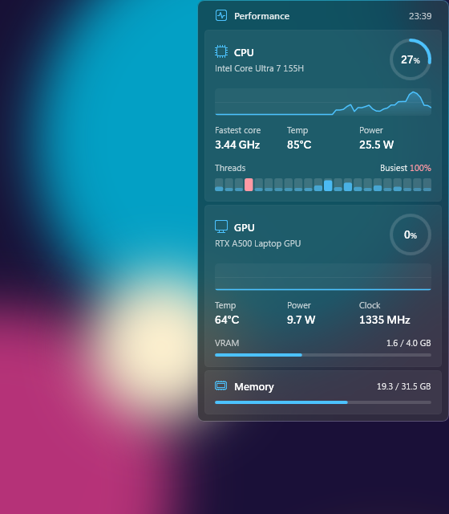
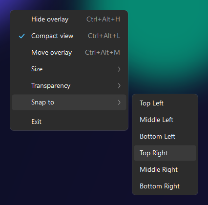

<div align="center">


# Fluent HUD

**A performance overlay for Windows games, built on the Windows 11 acrylic design system.**

CPU and GPU load, temperatures, clocks, power and memory for Intel, AMD and NVIDIA hardware, in a click-through panel that never takes focus from your game.

[Download](../../releases/latest) · [Report a bug](../../issues/new/choose) · [Contributing](CONTRIBUTING.md)



</div>

## Highlights

- **Real Windows 11 acrylic.** The same material as Start and context menus, drawn by Windows itself: blurred, tinted and brightness-balanced, with rounded corners, Segoe Fluent icons and your accent color.
- **Every vendor.** Intel and AMD CPUs; NVIDIA, AMD Radeon and Intel Arc or integrated GPUs. Each reading comes from the most accurate source the hardware offers.
- **Finds the bottleneck.** A bar per CPU thread shows the single saturated thread that an average hides, and readings turn yellow or red when they matter.
- **Says why, not just how much.** Flags when the CPU or GPU is being held back by heat or power.
- **Out of the way.** Click-through while locked, never activates, compact strip mode, snaps flush to any screen corner, global hotkeys.
- **Safe to run with games.** User mode only: no kernel driver, no injection, no network access.

## Supported hardware

| CPU metric | Intel | AMD |
| --- | --- | --- |
| Load, per-thread load, fastest-core clock | ✓ | ✓ |
| Temperature | Where the firmware exposes a CPU thermal zone (most laptops) | Same (rare on desktops) |
| Package power | Where Windows exposes a RAPL energy meter (most Intel laptops) | Same |
| Thermal-limit flag | With the CPU thermal zone | Same |

| GPU metric | NVIDIA | AMD Radeon | Intel Arc / integrated |
| --- | --- | --- | --- |
| Load | ✓ | ✓ | ✓ |
| Memory | VRAM | VRAM | VRAM, or shared GPU memory on integrated GPUs |
| Temperature | ✓ | ✓ | Arc graphics cards |
| Clock | ✓ | ✓ | ✓ |
| Power | ✓ | Radeon VII, RX 5000 series and newer | Arc graphics cards |
| Power / thermal / hardware limit flags | ✓ | — | — |

A reading your hardware doesn't expose shows "—" rather than a guess. Reading what's missing (for example the temperature of a desktop CPU) needs a kernel driver, which anti-cheat systems block; see [How the numbers are measured](#how-the-numbers-are-measured).

On a laptop with both an integrated and a dedicated GPU, Fluent HUD shows the dedicated one, the one games run on.

**Tested hardware.** Developed on an Intel Core Ultra 7 155H laptop with an NVIDIA RTX A500 Laptop GPU and Intel integrated graphics. There, GPU readings were checked against `nvidia-smi` and Windows' own GPU counters, through NVML, Intel's control library (clock) and the vendor-neutral path that AMD and Intel Arc cards use for temperature and clock. Not yet verified on real hardware: AMD CPUs, AMD's library (ADL, for Radeon board power), and Intel Arc's power and temperature. These follow AMD's and Intel's SDKs and Microsoft's documented APIs, and the AMD calls match the ones LibreHardwareMonitor uses. [Hardware reports](../../issues/new/choose) are very welcome.

## Install

Requires Windows 10 version 1903 or later, or Windows 11. The acrylic material needs Windows 11 22H2 or later; earlier versions get a blurred, tinted panel instead.

1. Download **FluentHudSetup.exe** from the [latest release](../../releases/latest).
2. Run it. It installs for your Windows account only, so there is no administrator prompt, and offers to start Fluent HUD with Windows.

`FluentHud.exe` from the same release also runs on its own without installing.

The installer isn't code-signed, so Windows SmartScreen may ask for confirmation (**More info → Run anyway**). To update, run a newer installer; it replaces the running copy. To uninstall, use **Settings → Apps → Installed apps → Fluent HUD**.

## Usage

| Hotkey | Action |
| --- | --- |
| <kbd>Ctrl</kbd>+<kbd>Alt</kbd>+<kbd>H</kbd> | Show or hide the overlay |
| <kbd>Ctrl</kbd>+<kbd>Alt</kbd>+<kbd>L</kbd> | Switch between the full panel and the compact strip |
| <kbd>Ctrl</kbd>+<kbd>Alt</kbd>+<kbd>M</kbd> | Unlock to move (drag, right-click for settings), or lock again |

While locked, the overlay is fully click-through, so it can never take a click meant for the game.

All settings are on the **tray icon** (it may be under the taskbar's **^** overflow arrow): hide, compact view, move, size (Small to Extra large), transparency (More, Standard, Off) and snap to a corner or edge. A corner means the actual corner of the screen.




**In games**, use **borderless** or **windowed fullscreen**. Exclusive fullscreen bypasses the Windows compositor, so no overlay window can draw over it.

### Warning colors

| Metric | Caution (yellow) | Critical (red) |
| --- | --- | --- |
| A single CPU thread | 85% | 97% |
| Total CPU load | 85% | 95% |
| CPU temperature | 95 °C | 100 °C |
| GPU temperature | 83 °C | 90 °C |
| RAM | 85% | 95% |
| VRAM / GPU memory | 90% | 97% |

GPU load never warns: 99% in a game means the GPU, not the CPU, is setting the frame rate, which is what you want.

## How the numbers are measured

Every value is an average over the last second, read from the same sources Windows and the GPU vendors' own tools use.

| Reading | Source |
| --- | --- |
| CPU load, per-thread load | `Processor Information` performance counters (busy time) |
| Fastest-core clock | Each core's `Processor Frequency` × its `% Processor Performance` |
| CPU temperature, thermal limit | The firmware's ACPI CPU thermal zone (`Thermal Zone Information`) |
| CPU power | RAPL package energy (`Energy Meter`), so a true average over the second |
| NVIDIA GPU | NVML, from the NVIDIA driver, polled five times a second for load and power |
| AMD GPU | Load and memory from Windows' GPU counters; temperature, clock and board power from ADL, from the AMD driver |
| Intel GPU | Load and memory from Windows' GPU counters; clock, power and temperature from IGCL, from the Intel driver (the clock is the highest it ran at during the second) |
| Any GPU | Load and memory from Windows' GPU counters; temperature and clock from D3DKMT, as Task Manager reads them, wherever the vendor library gives none |
| RAM | `GlobalMemoryStatusEx` (in use = total − available) |

**CPU load reads lower than Task Manager.** Task Manager shows *utility*: busy time scaled by how far the core is boosted above its base clock, capped at 100%. On a chip that boosts to three times its base clock, a thread that is busy a third of the time already reads 100% there. Fluent HUD shows busy time, so a thread at 100% really has nothing left, which is what a CPU bottleneck looks like.

**"asleep" and "idle".** A laptop's dedicated GPU powers down when nothing is using it, and while it's down there is no temperature or power to read. Fluent HUD doesn't wake it to ask: it shows the GPU as asleep or idle until a game starts using it.

### Known limitations

- **No FPS counter.** FPS and frame times need either hooking into the game or an administrator-only trace session, so they are left to the game's own counter.
- **Some sensors aren't exposed.** Per-core and most desktop CPU temperatures need a kernel driver. Intel integrated GPUs report no power or temperature of their own (their power is part of the CPU package figure).
- **Mixed display scaling.** On a second monitor with a different scale from the main one, Windows scales the panel and it can look slightly soft.

## Safe to use with games

Fluent HUD never opens, reads or injects into a game's process, and it loads no kernel driver. Its readings come from Windows performance counters, DXGI and D3DKMT, and the user-mode libraries NVIDIA, AMD and Intel install with their drivers. It makes no network connections and collects no data.

No anti-cheat vendor certifies third-party overlays, but Fluent HUD uses only the interfaces Task Manager and vendor control panels use.

## Troubleshooting

- **A reading shows "—".** Your hardware or firmware doesn't expose it. A [diagnostics report](#diagnostics-report) shows which sources were found.
- **The overlay doesn't appear over a game.** Switch the game to borderless or windowed fullscreen.
- **The hotkeys do nothing.** Another app already uses one of the combinations; a notification says so at launch. Use the tray icon instead.
- **AMD or Intel GPU readings stopped after a crash.** If the app ever stops while a GPU vendor's library is starting, it skips that library from then on, so a faulty driver can't stop Fluent HUD from launching. Delete `adl-starting.marker` or `igcl-starting.marker` in `%APPDATA%\FluentHud` to try again.

Settings live in `%APPDATA%\FluentHud\settings.txt` and errors are logged to `%APPDATA%\FluentHud\error.log`.

### Diagnostics report

When reporting a problem, please attach a diagnostics report. It lists the detected hardware, where each reading comes from, and five one-second samples. In PowerShell, in the folder that holds `FluentHud.exe` (the installed copy is in `%LOCALAPPDATA%\Programs\FluentHud`), run:

```powershell
Start-Process .\FluentHud.exe '--probe report.txt' -Wait
```

It takes about six seconds and writes `report.txt` to that folder.

## Building from source

No SDK is needed: the build uses the C# compiler that ships with Windows (.NET Framework 4.8).

```powershell
./build.ps1   # bin\FluentHud.exe and dist\FluentHudSetup.exe
./test.ps1    # unit tests, then install/update/uninstall into a temporary folder
```

| Path | Contents |
| --- | --- |
| `src/` | The overlay: window, layout (`Overlay.xaml`), controls, thresholds, settings |
| `src/Sensors/` | Hardware readers: CPU, NVML, ADL, IGCL, DXGI, D3DKMT |
| `installer/` | The per-user installer and uninstaller |
| `tests/` | Unit tests and the end-to-end installer test |
| `tools/` | Generates the app icon |

## Contributing

Bug reports, hardware reports and pull requests are welcome. See [CONTRIBUTING.md](CONTRIBUTING.md).

## License

[MIT](LICENSE) © 2026 Saatvik Sharma.

AMD GPU support uses constants from AMD's [display-library](https://github.com/GPUOpen-LibrariesAndSDKs/display-library) SDK (MIT). Fluent HUD is not affiliated with Microsoft, AMD, Intel or NVIDIA.
